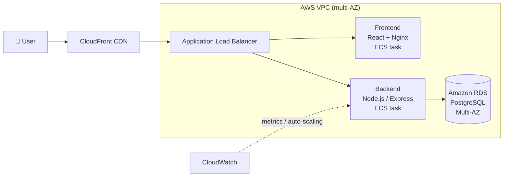

# ☁️ 3-Tier Cloud Application on AWS


A containerized **3-tier web application** (presentation, application and data layers), designed to be deployed on a **highly available AWS infrastructure**.
Built as a Cloud Computing project during my Software Engineering degree.

## 🏗️ Architecture



| Layer | Technology | AWS service |
|---|---|---|
| Presentation | React (Vite, TypeScript), served by Nginx | ECS + CloudFront |
| Application | Node.js, Express REST API | ECS (auto-scaling on CloudWatch metrics) |
| Data | PostgreSQL | RDS Multi-AZ |

**Infrastructure highlights**
- Custom **VPC** with public and private subnets across several Availability Zones
- **Application Load Balancer** and **Auto Scaling**
- Workloads migrated from **EC2 to Docker containers on Amazon ECS**
- **RDS Multi-AZ** for database failover, **S3** and **CloudFront** for static delivery
- **Health checks** at every layer (`/health`, `/api/health/db`, `pg_isready`)

## 🚀 Run locally

Requirements: Docker and Docker Compose.

```bash
git clone https://github.com/bechirrrr/cloud-project.git
cd cloud-project
cp .env.example .env                   # set DB_PASSWORD
docker compose up --build
```

| Service | URL |
|---|---|
| Frontend | http://localhost:3000 |
| Backend API | http://localhost:4000 |
| PostgreSQL | localhost:5433 |

## 🔌 API endpoints

| Method | Endpoint | Description |
|---|---|---|
| GET | `/health` | Backend health check |
| GET | `/api/health/db` | Database connectivity check |
| GET | `/api/message` | Reads a message from PostgreSQL |

## 📁 Project structure

```
cloud-project/
├── frontend/          # React + Vite app, multi-stage Dockerfile, Nginx config
├── backend/           # Express API + pg connection pool
├── db/                # PostgreSQL image + init.sql (schema and seed data)
└── docker-compose.yml # Local orchestration with health checks
```

## 👤 Author

**Bechir Marweni**: [LinkedIn](https://www.linkedin.com/in/bechir-marweni-790032279) · [GitHub](https://github.com/bechirrrr)
